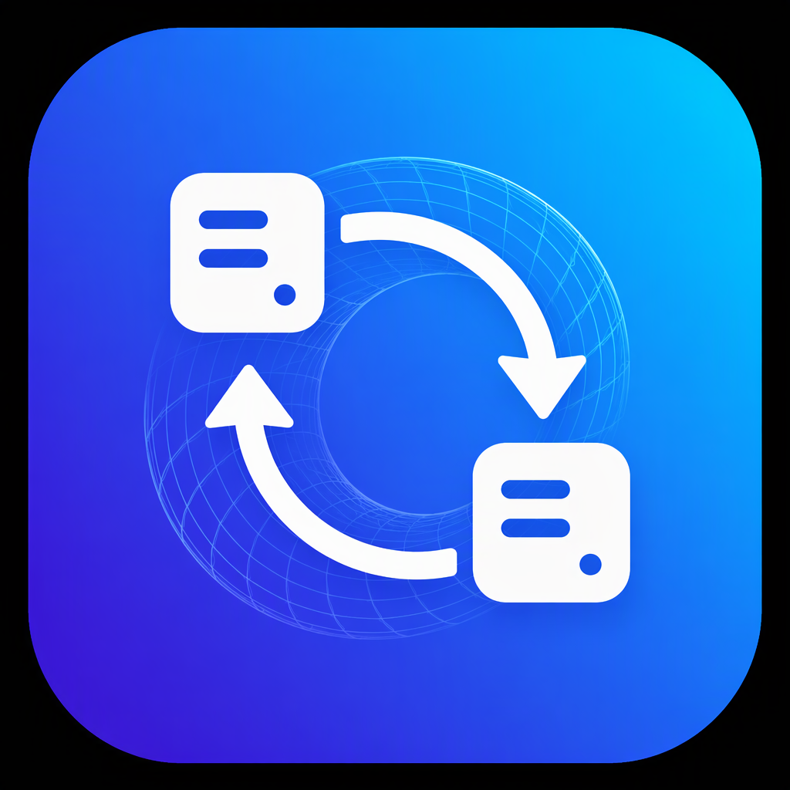
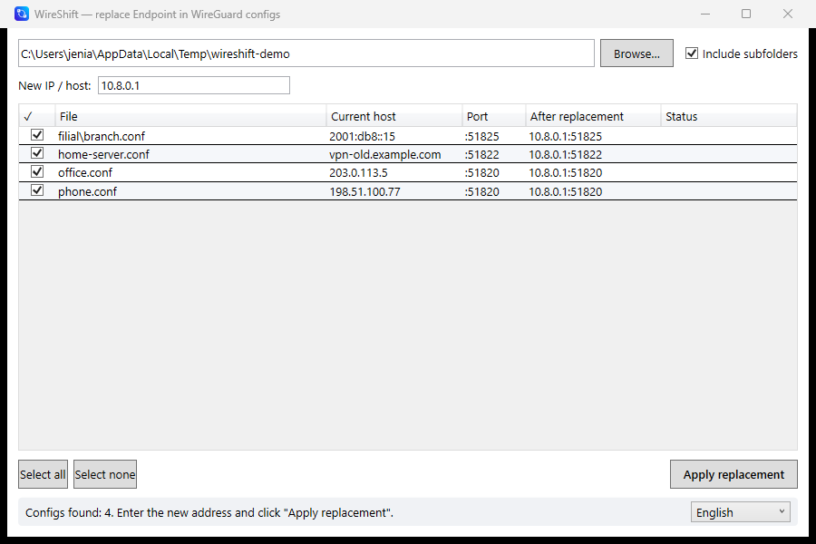

# WireShift

**[Русская версия](README.md)**



**WireShift** is a small Windows utility for batch-replacing the `Endpoint` address in WireGuard/Amnezia configs (`.conf`).
Pick a folder — see all current addresses — type the new one — done.

Available in **Russian and English** (switchable in the app; follows the system language by default).

## Features

- 📁 Scans a folder for configs (optionally including subfolders)
- 📋 Lists every config found: file, current host, port
- 👁 Live preview of what `Endpoint` will look like after replacement
- ✅ Selective replacement — tick the files you want to change
- 🔌 The port is preserved automatically: `1.2.3.4:51820` → `10.0.0.1:51820`
- 🌐 The new address can be IPv4, IPv6 (wrapped in `[...]`) or a hostname
- 💾 A `.bak` backup is created before writing (an existing backup is never overwritten)
- 🧷 File-safe: encoding (UTF-8 BOM / UTF-16) and line endings are preserved, commented-out lines are left untouched
- 🌍 RU/EN interface, switchable at runtime

## Screenshot



## Command-line arguments

```powershell
# Open a folder right at startup (handy for "Open with")
WireShift.exe "C:\vpn\configs"

# Also prefill the new address
WireShift.exe "C:\vpn\configs" 10.8.0.1
```

## Download

Get the ready-made `WireShift.exe` (single-file, no .NET required) from the **Releases** page.

## Build from source

Requires the [.NET SDK 9](https://dotnet.microsoft.com/download).

```powershell
# Regular build (requires the .NET 9 Desktop Runtime on the machine)
dotnet build -c Release

# Self-contained single-file exe (~128 MB, zero prerequisites)
dotnet publish -c Release -r win-x64 --self-contained true `
  -p:PublishSingleFile=true -p:IncludeNativeLibrariesForSelfExtract=true
```

Output: `bin\Release\net9.0-windows\win-x64\publish\WireShift.exe`

## Tests

```powershell
dotnet run --project tests/LogicTests -c Release
```

## How it works inside

The replacement logic lives in `EndpointRewriter.cs`: a regex finds the first
uncommented `Endpoint = host:port` line, parses the address (including bracketed
IPv6), substitutes the new host, and leaves the port and the rest of the line
untouched. The GUI is WPF (`MainWindow.xaml`), the grid is backed by an
`ObservableCollection<ConfigEntry>`, and UI strings live in `Loc.cs` (RU/EN).

## License

[MIT](LICENSE)
