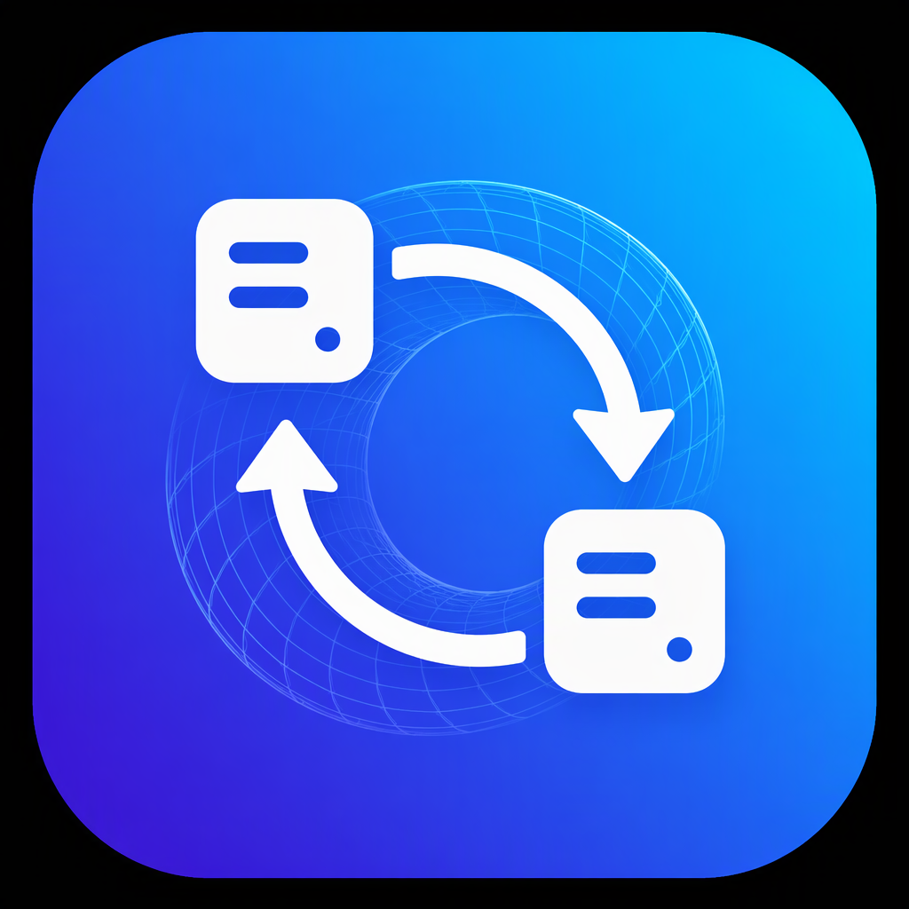
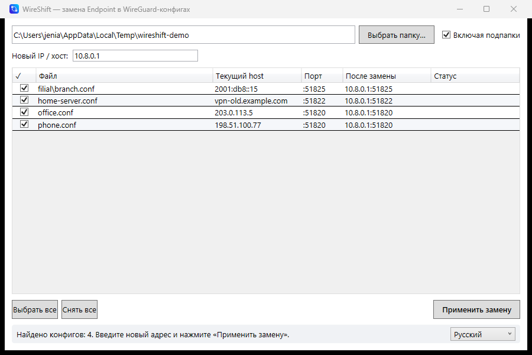

# WireShift

**[English version](README.en.md)**



**WireShift** — небольшая Windows-утилита для массовой замены `Endpoint` в конфигах WireGuard/Amnezia (`.conf`).
Выбираете папку — видите все текущие адреса — вводите новый — готово.

## Возможности

- 📁 Сканирование папки с конфигами (с учётом подпапок — по желанию)
- 📋 Таблица всех найденных конфигов: файл, текущий host, порт
- 👁 Живой предпросмотр: как будет выглядеть `Endpoint` после замены
- ✅ Выборочная замена — галочками отмечаете, какие файлы менять
- 🔌 Порт сохраняется автоматически: `1.2.3.4:51820` → `10.0.0.1:51820`
- 🌐 Новый адрес может быть IPv4, IPv6 (оборачивается в `[...]`) или доменом
- 💾 Перед записью создаётся резервная копия `.bak` (существующая не затирается)
- 🧷 Аккуратно с файлами: сохраняются кодировка (UTF-8 BOM / UTF-16) и переводы строк, закомментированные строки не трогаются
- 🌍 Интерфейс на русском и английском, переключается на лету

## Скриншот



## Запуск с аргументами

```powershell
# Открыть папку сразу при запуске (удобно для «Открыть с помощью»)
WireShift.exe "C:\vpn\configs"

# И сразу подставить новый адрес
WireShift.exe "C:\vpn\configs" 10.8.0.1
```

## Скачать

Готовый `WireShift.exe` (single-file, .NET не требуется) — на странице **Releases**.

## Сборка из исходников

Требуется [.NET SDK 9](https://dotnet.microsoft.com/download).

```powershell
# Обычная сборка (требует .NET 9 Desktop Runtime на машине)
dotnet build -c Release

# Автономный single-file exe (~128 МБ, ничего не требует)
dotnet publish -c Release -r win-x64 --self-contained true `
  -p:PublishSingleFile=true -p:IncludeNativeLibrariesForSelfExtract=true
```

Результат: `bin\Release\net9.0-windows\win-x64\publish\WireShift.exe`

## Тесты

```powershell
dotnet run --project tests/LogicTests -c Release
```

## Как это работает внутри

Логика замены — в `EndpointRewriter.cs`: regex находит незакомментированную строку
`Endpoint = host:port`, разбирает адрес (включая IPv6 в квадратных скобках),
подставляет новый host, порт и остаток строки остаются нетронутыми.
GUI — WPF (`MainWindow.xaml`), данные таблицы — `ObservableCollection<ConfigEntry>`.

## Лицензия

[MIT](LICENSE)
